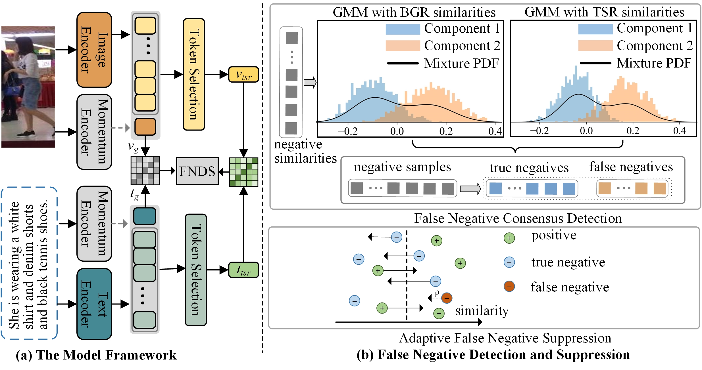

# False Negatives Consensus Suppression for Text-to-Image Person Re-identification

Official PyTorch implementation of the paper False Negatives Consensus Suppression for Text-to-Image Person Re-identification.

## Overview

This repository contains the open-source implementation of FNDS—a framework designed to address the false negative problem in Text-to-Image Person Re-identification (TIReID). In TIReID, a textual query is used to retrieve relevant pedestrian images. While existing methods rely on image–text contrastive learning by considering only the paired samples as positive, our work reveals that many negative samples are, in fact, semantically related to the query (i.e., false negatives). FNDS mitigates their adverse impact using:

- **False Negative Consensus Detection (FNCD):** A dual-grained detection mechanism that leverages both global and fine-grained feature representations to reliably identify potential false negatives.
- **Adaptive False Negative Suppression (AFNS):** An adaptive weighting strategy that suppresses the negative influence of these false negatives during training.
- **Cross-modal Momentum Contrastive (CM-MoC) Module:** A dynamic negative-sample queue mechanism that enhances the robustness of the similarity estimation between modalities.

Our experiments on benchmark datasets (CUHK-PEDES, ICFG-PEDES, and RSTPReid) demonstrate that FNDS significantly improves retrieval performance.

 

## Repository Structure

```
├── README.md          # This file
├── configs/           # Configuration files for training and evaluation
├── data/              # Instructions and scripts to download datasets
├── models/            # Model definitions and architectures
├── scripts/           # Training and evaluation scripts
└── requirements.txt   # Python dependencies
```

## Installation

### Dependencies

```
pytorch 1.9.0
torchvision 0.10.0
prettytable
easydict
```

Ensure you have Python 3.8 or higher installed. Then, clone the repository and install the required dependencies:

```bash
git clone https://github.com/your-username/FNDS.git
cd FNDS
pip install -r requirements.txt
```

## Datasets

Download the CUHK-PEDES dataset from [here](https://github.com/ShuangLI59/Person-Search-with-Natural-Language-Description), ICFG-PEDES dataset from [here](https://github.com/zifyloo/SSAN) and RSTPReid dataset form [here](https://github.com/NjtechCVLab/RSTPReid-Dataset).

Organize them in `your dataset root dir` folder as follows:

```
|-- your dataset root dir/
|   |-- <CUHK-PEDES>/
|       |-- imgs
|            |-- cam_a
|            |-- cam_b
|            |-- ...
|       |-- reid_raw.json
|
|   |-- <ICFG-PEDES>/
|       |-- imgs
|            |-- test
|            |-- train 
|       |-- ICFG_PEDES.json
|
|   |-- <RSTPReid>/
|       |-- imgs
|       |-- data_captions.json
```


## Training

To train the FNDS model, run the training script. For example:

```bash
sh options/run_cuhk_peds.sh
```

The training script file contains key hyperparameters such as:

- Learning rates for the pre-trained backbone and newly initialized layers
- Batch size and training epochs
- False negative probability threshold (δ) and token selection ratio (R)
- Momentum queue sizes for the CM-MoC module

## Evaluation

After training, you can evaluate the model performance using:

```bash
sh tese.sh
```

The evaluation metrics include Recall at K (R@K) and mean Average Precision (mAP).

## Citation

If you find our work useful, please cite our paper:

> Anonymous, "False Negatives Consensus Suppression for Text-to-Image Person Re-identification," 

## License

This project is licensed under the MIT License. See the [LICENSE](https://chatgpt.com/c/LICENSE) file for details.

## Acknowledgements

We thank the authors of  [CLIP](https://github.com/openai/CLIP) and related work [IRRA](https://github.com/anosorae/IRRA) for providing the foundational models and inspiration behind this project.

## Contact

For any inquiries or issues, please open an issue on GitHub.
